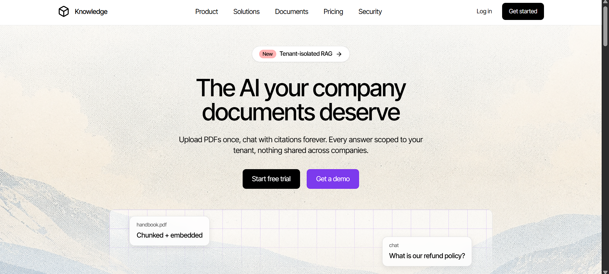
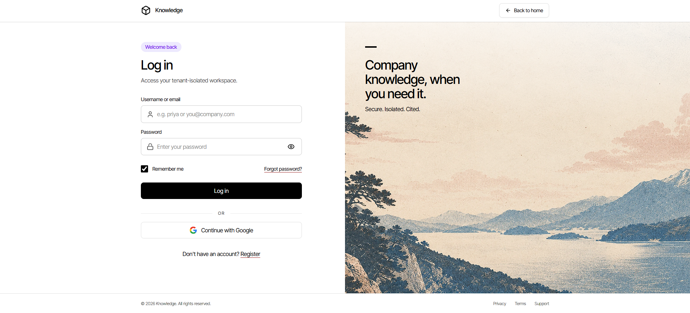
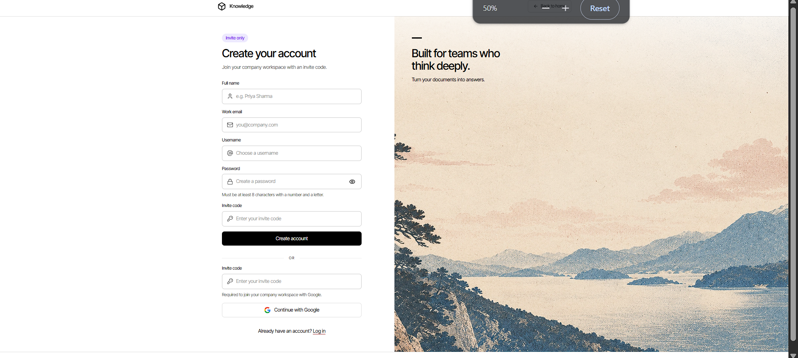
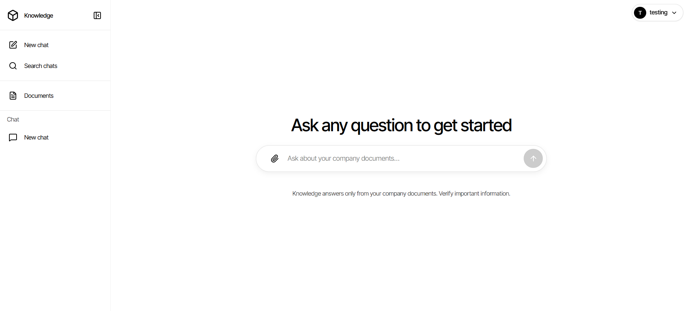
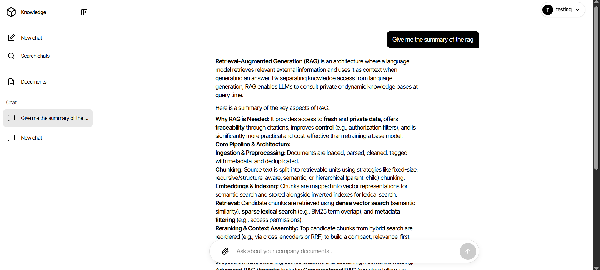

# Knowledge AI — Multi-Tenant Company Knowledge App

Ask questions about your company's documents and get cited answers with AI.

Each company has its own isolated workspace. Users chat with their company's documents only. Admins upload documents, manage users. Superadmins manage companies.



## Screenshots

| Homepage | Login | Register |
|----------|-------|----------|
|  |  |  |

| Dashboard | Asking | Answer |
|-----------|--------|--------|
|  |  |  |

## Features

- **Multi-tenant workspaces** — companies isolated by invite code
- **Document knowledge base** — upload PDF / TXT, auto chunk + embed
- **RAG chat** — answers only from your company docs, with sources
- **Streaming answers** — token-by-token responses (SSE)
- **File attachments in chat** — PDF, TXT, PNG, JPG per message + follow-up reuse
- **Roles** — `user`, `company_admin`, `superadmin`
- **Auth** — username/password (JWT) + Google login via Auth0
- **Admin tabs** — Documents, Users, Companies, Promote

## Tech Stack

**Backend (`backend/`):**
Django 6.1, Django REST Framework, SimpleJWT, PostgreSQL + pgvector, Google Gemini (`gemini-embedding-001` + `gemini-3.6-flash`), Pillow, pypdf

**Frontend (`frontend/`):**
React 19, Vite, TypeScript, TailwindCSS 4, React Router 8, Axios, Auth0 React SDK, Lucide icons

## Project Structure

```
backend/
  config/          Django settings + root URLs
  apps/
    accounts/      User, register, login, Google/Auth0 login, /me
    companies/     Company tenant, invite codes, promote, user management
    documents/     Upload, text extract, chunk, embed
    chat/          Conversations, messages, RAG, streaming
frontend/src/
  features/auth/       Login, register, Auth0 button
  features/dashboard/  Chat + sidebar + admin tabs
  components/          App shell, UI kit, home page
  lib/api.ts           Axios + JWT refresh handling
DESIGN.md              Design system (colors, buttons, layout)
```

## Prerequisites

- Python 3.12+
- Node.js 18+ + npm or bun
- PostgreSQL 14+ with `pgvector` extension
- Google Gemini API key
- Auth0 account (optional, for Google login)

## Setup

### 1. Database

Create a Postgres database and enable pgvector:

```sql
CREATE DATABASE company_knowledge_ai;
CREATE USER company_knowledge_ai WITH PASSWORD 'yourpassword';
GRANT ALL PRIVILEGES ON DATABASE company_knowledge_ai TO company_knowledge_ai;
-- then connect to the db and run:
CREATE EXTENSION IF NOT EXISTS vector;
```

### 2. Backend

```bash
cd backend
python -m venv .venv
# Windows:
.venv\Scripts\activate
# Mac/Linux:
# source .venv/bin/activate

pip install -r requirements.txt
pip install pgvector==0.5.0
```

Copy env and fill it in:

```bash
copy .env.example .env
```

`backend/.env`:
```
DB_NAME=company_knowledge_ai
DB_USER=company_knowledge_ai
DB_PASSWORD=your_db_password_here
DB_HOST=127.0.0.1
DB_PORT=5432
GEMINI_API_KEY=your_gemini_api_key_here
AUTH0_DOMAIN=your-tenant.us.auth0.com
AUTH0_AUDIENCE=your-auth0-client-id
```

Run migrations + start server:

```bash
python manage.py migrate
python manage.py createsuperuser   # this becomes your superadmin
python manage.py runserver
```

Backend runs at `http://localhost:8000`. API at `http://localhost:8000/api`.

### 3. Frontend

```bash
cd frontend
npm install
```

Copy env (only needed for Google login):

```bash
cp .env.example .env
```

`frontend/.env`:
```
VITE_AUTH0_DOMAIN=your-tenant.us.auth0.com
VITE_AUTH0_CLIENT_ID=your-auth0-client-id
```

Start dev server:

```bash
npm run dev
```

Frontend runs at `http://localhost:5173`.

> Without Auth0 vars, username/password login still works. Social button just shows a notice.

## How to Use

### 1. Landing, login and register

Landing page explains the product.


Login with username/password or Continue with Google.


New members join with an invite code from their company.


### 2. Create company and invite users

1. Login as superadmin at `/login` (the `createsuperuser` account).
2. Go to Dashboard → **Companies** tab → Create company → copy its **invite code**.
3. Go to **Promote** tab to promote a user to `company_admin`.
4. Register new users at `/register` with the invite code.

### 3. Upload documents and chat

Empty dashboard — ask a question or upload first.


As `company_admin`: **Documents** tab → upload PDF/TXT → wait for status `ready`.

Ask in the **Chat** tab.


Answers stream in with citations from your company docs only.


## User Roles

| Role | Can do |
|------|--------|
| `user` | Chat, view documents |
| `company_admin` | Above + upload/delete docs, activate/deactivate company users |
| `superadmin` | Above + create/delete companies, promote users to admin |

## API Overview

```
POST /api/auth/register/          Register with invite_code
POST /api/auth/login/             JWT login
POST /api/auth/token/refresh/     Refresh token
POST /api/auth/auth0/             Social login {id_token, invite_code?}
GET  /api/auth/me/                Current user

GET/POST /api/companies/          List/create (superadmin)
DELETE   /api/companies/<id>/     Delete tenant
GET      /api/companies/users/     Company users (admin)
PATCH    /api/companies/users/<id>/  Activate/deactivate
GET      /api/companies/all-users/    All users (superadmin)
POST     /api/companies/promote/<id>/ Promote to admin

GET/POST /api/documents/          List/upload (upload = admin only)
DELETE   /api/documents/<id>/     Delete doc

GET/POST /api/conversations/              List/create chat
PATCH    /api/conversations/<id>/         Rename chat
GET/POST /api/conversations/<id>/messages/        History / ask (sync)
POST     /api/conversations/<id>/messages/stream/ Ask with streaming (SSE)
```

## Notes

- Document processing is synchronous — large PDFs take a few seconds on upload.
- Chat needs `GEMINI_API_KEY`, otherwise it returns "couldn't find information".
- Media uploads are stored in `backend/media/`.
- CORS allows `http://localhost:5173` by default (see `backend/config/settings.py`).
